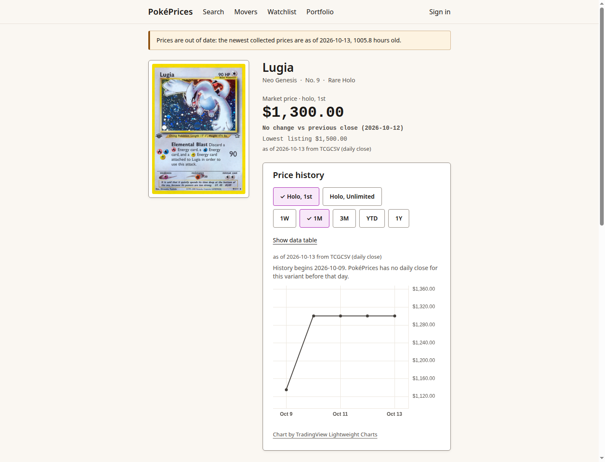
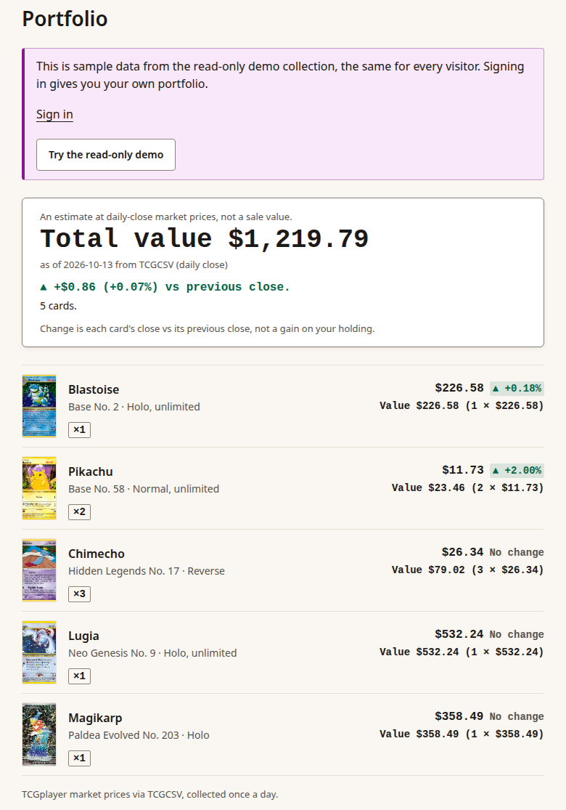
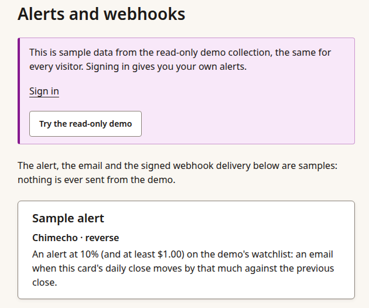
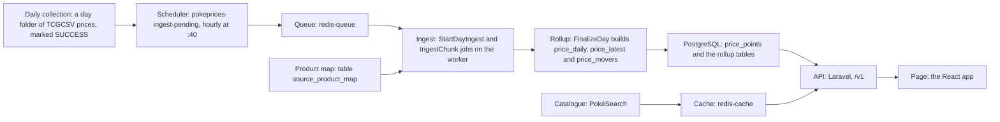

# PokéPrices

PokéPrices is a Pokémon card price tracker, live at <https://pokeprices.andrestheperez.com>: search a card, see what it closed at, how that compares with the previous close and how its price has moved. Prices are collected once a day; each one is shown with its source and the day it is as of, and none is an intraday quote.

PokéPrices is a personal portfolio project, not a business. It has no ads, no affiliate links and no paid features, and it sells no data. It exists to show how I build and run software.

The code is published to be read, and all rights are reserved.

## See it working

You do not need an account. Open the [home page](https://pokeprices.andrestheperez.com/) and scroll to "See it working". The Watchlist, Portfolio and Alerts pages also open without signing in, and each says it shows sample data. For what needs a session, press `Try the read-only demo` on the home page. That signs the browser in to a shared account with a watchlist, a portfolio and a sample alert, in which nothing can be changed. No address opens the demo by itself. The home page also shows a sample of the demo's collection under "See it working" with no sign-in: its portfolio total, three watched cards and an alert.









## What it is built with

- **API:** PHP 8.5 and Laravel 13, with Fortify and Sanctum for accounts and sessions, served under `/v1`. Tests run with Pest.
- **Web:** React 19.3.0, TypeScript 6.0.3, Vite 8.3.4 and Tailwind CSS 4.3.3, with TanStack Query 5.104.2 for reads and lightweight-charts 5.2.1 for the price chart. Tests run with Vitest 5.0.3.
- **Data:** PostgreSQL 17 for prices and accounts; two Redis 8 instances, one for the job queue and one for the cache.
- **Run:** Docker Compose, with the built app served by unprivileged nginx. Node 22 builds the web app.
- **Where the data comes from:** TCGplayer market prices, collected once a day through TCGCSV; card names and pictures from the PokéSearch catalogue, a separate project.

## How a price gets to the page



The collector writes a day folder; its code is not in this repository. The hourly scan at :40 queues an ingest for each new day. The product map says which card variant each marketplace product belongs to. When every chunk of a day is in, the rollup writes the day's closes and the movers board. The API reads those tables, and reads card names and pictures from the catalogue through the cache.

## What is interesting

- **Every price says where it is from and when.** A card page stamps each variant's price `as of <day>
  from TCGCSV (daily close)` and prints the day of the previous close beside the change. A list (the
  movers board, the watchlist, the portfolio) is stamped once with the day or days of its closes and
  their source, and says once that its changes are against the previous close. The rules are in
  [`docs/WEB.md`](docs/WEB.md#what-every-price-shows).
- **Marketplace products are mapped to catalogue cards, and the map is audited.** The price feed lists
  marketplace products; a product map decides which card variant each price belongs to. Five audit
  checks (`pokeprices:map:audit`: `names`, `constraints`, `coverage`, `ambiguity`, `priced`) and a
  golden set judge a new map before history is replayed onto it: see
  [Map rebuild then replay](docs/OPERATIONS.md#map-rebuild-then-replay).
- **The movers board ranks only real market moves.** A variant is ranked only when it moved at least 5%
  and at least $1.00 from a previous close of at least $2.00, when four of its last five closes differ,
  and when both closes lie between half the low listing and one and a half times the mid listing. The
  thresholds and the measurements behind them are in
  [`docs/measurements/movers-eligibility.md`](docs/measurements/movers-eligibility.md).
- **Price moves go out as signed webhooks, and the read-only demo shows one.** When a card on an
  account's watchlist or portfolio moves by at least 5% and $1.00 between two daily closes, each of the
  account's signed webhooks gets a message signed with the Standard Webhooks scheme (HMAC-SHA256);
  per-card alerts go by email or Discord. The demo's Alerts page shows a sample delivery with its
  headers, its exact body and a published sample secret, so the signature can be checked by hand;
  nothing is ever sent from the demo. See [`docs/ALERTS.md`](docs/ALERTS.md#the-demos-samples).
- **The API contract, the web app's types and the code cannot drift apart unnoticed.**
  [`openapi/api.json`](openapi/api.json) is exported from the API code and
  [`web/src/api/schema.d.ts`](web/src/api/schema.d.ts) is generated from it; `make test` fails when
  either differs from a fresh copy. `make gates` runs every gate of
  [`gates/manifest-P0.md`](gates/manifest-P0.md) into a scorecard.

## Problems and how I solved them

Eight problems, each with the file, test or command that shows the answer. Figures are dated; each command recounts.

1. **Marketplace products have to land on the right card, and a wrong map has to be caught before history is
   replayed onto it.** `api/app/Domain/Mapping/MapBuilder.php` assigns each TCGplayer product and subtype to one
   card variant. `api/app/Domain/Mapping/MapAudit.php` runs five checks on the result, and a golden set of 71 rows
   (`api/database/data/golden-set.json`) names the product each card must map to and the products it must never
   map to. On the development data, map build 4 (the 2026-10-11 collection) maps 20,193 of 20,635 catalogue cards,
   97.86 % against a floor of 96 %; before the rules for hyphenated EX and GX names, Prism Star, Unown and rarity
   tags it was 89.46 %, which that check would have failed ([the steps](docs/OPERATIONS.md#map-rebuild-then-replay);
   test: `api/tests/Feature/Mapping/MapAuditPricedTest.php`).

   ```sh
   docker compose -f compose.dev.yml exec -T -w /workspace/api api php artisan pokeprices:map:audit --check priced --json
   ```

2. **A daily job that fails quietly is the worst kind, so the price job reports on itself.** One list in
   `api/app/Domain/Pricing/PriceJobProblems.php` holds what is wrong: prices past the 26-hour limit, a day with no
   finished run, a refused day folder, a run stuck for three hours, a day that failed twice and is on hold. The
   freshness answer's `missing_days` and an hourly command (`api/app/Console/Commands/PricesReportProblems.php`)
   read that same list. The command posts one Discord message when a problem starts and one when it ends, and
   records it in `reported_price_problems`, so a restart repeats nothing. A failed post is retried the next hour
   and prints one line with the status, never the address. A missing day stops deciding freshness at 15 days old.
   Tests: `api/tests/Feature/Pricing/PriceJobProblemsTest.php`, `PriceProblemReportTest.php` beside it. On
   2026-11-25 the public site answered day 2026-11-24, `within_slo` true, no missing days:

   ```sh
   curl -s https://pokeprices.andrestheperez.com/v1/prices/freshness | jq -c '.data | {day, age_hours, slo_hours, within_slo, missing_days}'
   ```

3. **A movers board full of thin-market noise is worse than none, so it ranks only real market moves.** A variant
   is ranked only when it moved at least 5 % and $1.00 from a previous close of at least $2.00, when four of its
   last five closes differ, and when both closes lie between half the low listing and 1.5 times the mid listing
   (`api/app/Domain/Pricing/Movers.php`). On the development data for 2026-10-13, 3,444 variants had a changed close
   and a previous close of $2.00 or more; the board ranks 19 (6 rises, 13 falls). The largest rise before the rule,
   `ex13-3` reverse, went from 5.00 to 752.00 (+14,940 %) after an earlier close at 0.009 times its low listing.
   Each edge is pinned: 5.00 % counts, 4.99 % does not (`api/tests/Feature/Pricing/MoversEligibilityTest.php`);
   [the measurements](docs/measurements/movers-eligibility.md).

   ```sh
   docker compose -f compose.dev.yml exec -T postgres psql -U pokeprices -d pokeprices -c "select direction, count(*) from price_movers where day = '2026-10-13' group by 1 order by 1"
   ```

4. **A webhook receiver should not have to trust me, so each delivery is signed and the signature can be checked
   by hand.** Messages follow the Standard Webhooks scheme: `webhook-signature` is `v1,` plus the base64
   HMAC-SHA256 of `<id>.<timestamp>.<body>` (`api/app/Domain/Alerts/WebhookSigner.php`, tested against the
   scheme's published vector in `api/tests/Unit/Alerts/WebhookSignerTest.php`). The Alerts page shows one sample
   delivery signed with a published sample secret; nothing is ever sent from the demo. This recomputes that
   signature from what the dev API serves (on 2026-11-25 its two lines were identical);
   `web/src/account/AlertsSample.review.test.tsx` does it from the rendered page; [the steps](docs/ALERTS.md#signed-webhooks).

   ```sh
   r=$(curl -s pokeprices.localhost:8095/v1/demo/alerts)
   key=$(printf '%s' "$r" | jq -r .data.sample_secret | sed 's/^whsec_//' | base64 -d | xxd -p -c 256)
   printf '%s' "$r" | jq -j '.data.webhook | .headers["webhook-id"], ".", .headers["webhook-timestamp"], ".", .body' |
     openssl dgst -sha256 -mac HMAC -macopt hexkey:"$key" -binary | base64
   printf '%s' "$r" | jq -r '.data.webhook.headers["webhook-signature"]'   # the same, after "v1,"
   ```

5. **Rate limits that run after the session starts let a stranger fill the sessions table, so a guest is counted
   before any session exists.** `api/app/Http/Middleware/ThrottleBeforeSession.php` runs first and counts each
   address at 60 a minute. It decides whether a request is signed in by decrypting the session cookie and reading
   one `sessions` row by primary key (`api/app/Domain/Accounts/SignedInSession.php`), without starting a session; a
   request with no cookie costs no query. A guest's request to a sign-in-only route is answered `401` right after
   it is counted, so it stores no row. On dev every visitor shares one address, so these buckets are global there;
   production trusts the proxy's forwarded address (`api/tests/Feature/TrustedProxiesTest.php` pins both). Test:
   `api/tests/Feature/Accounts/GuestRateLimitTest.php`; [all the limits](docs/ACCOUNTS.md#rate-limits).

6. **A Redis outage must not become a stack trace, so each role's outage has a defined answer.**
   `api/tests/Feature/CacheOutageTest.php` points each of the two Redis roles at an address nothing answers on and
   checks the answers. With `redis-queue` (queue, rate limiters, catalogue locks) down, a rate-limited route
   answers a `503` problem with `Retry-After`: a limit that cannot be counted is refused, not waved through. With
   `redis-cache` (catalogue data) down, the movers board and the watchlist still answer `200` with no card names
   and `meta.degraded` true, while a card page and a search answer `503`: the catalogue is read through the cache,
   never around it. When the catalogue itself is down, cards come from a last good copy kept 7 days, but it lives
   only in `redis-cache` and a restart loses it (`api/tests/Feature/Cards/CardLastGoodLimitTest.php`);
   [the table](docs/OPERATIONS.md#a-redis-outage).

7. **An API and its web client drift apart without a sound, so `make test` holds the contract, the generated
   types and the code together.** `openapi/api.json` is exported from the API code and `web/src/api/schema.d.ts`
   is generated from it; the `test` target in `Makefile` exports and generates fresh copies and fails if either
   committed file differs, and the Pest suite validates every `/v1` answer against the contract. On 2026-11-25
   `make test` took 3 min 26 s here: Pest 4,428 tests (34,732 assertions), Vitest 219 files with 2,995 tests and
   one expected failure, then `tsc`, ESLint and both comparisons. CI runs it.

8. **"It passes" needs a definition, so the checks are a list and the result is a scorecard.**
   `gates/manifest-P0.json` lists 39 gates, 34 hard and 5 soft, from static analysis and coverage to a secret scan
   of the full history. `make gates` runs them into a scorecard (`scripts/scorecard`) and `make verdict` turns it
   into a pass or fail; `gates/frozen.sha256` pins the files whose settings must not loosen. The full run took
   about 34 minutes the last time I ran it (2026-11-24), so it is not part of CI. The fast tier runs 21 of the
   gates (19 hard, 2 soft) and the tests of the gate scripts, and ends non-zero on any failure (`tests/p0/run.sh`):

   ```sh
   TIER=fast sh tests/p0/run.sh
   ```

### Decisions and trade-offs

- [Day close](docs/adr/0001-day-close.md): a price is a daily close, a missing day is carried forward and marked.
- [Daily polling and the ticker](docs/adr/0002-daily-polling-and-ticker.md): pages ask again every five minutes
  instead of holding a push connection, and the chart is a line of closes, not candles.
- [Accounts and sessions](docs/adr/0003-accounts-and-sessions.md): sign-up needs an invite code, sessions are
  same-origin cookies with no tokens, and the shared demo is read-only on the server. Nobody signs up unaided.
- [Alert delivery](docs/adr/drafts/0004-alert-delivery.md), still a draft: webhooks are delivered at least once, and
  the receiver drops duplicates by `webhook-id`.

### What I would do next

- A price history backfill: a card's chart begins on the first day I collected it, and the page says so.
- Mapping gaps: at map build 4, 442 of 20,635 catalogue cards have no mapped product (development data).
- Card pictures come from third-party hosts (`docker/nginx/pokeprices.conf` names both); one is being retired.
- Backups kept off the server: the nightly dump stays on the same server ([`docs/DEPLOY.md`](docs/DEPLOY.md#step-15-backup-timer-server)).
- A mail provider, so sign-up can open: mail goes to the log today and accounts are invite-only.
- Enforcing the content policy, which the page sends as report-only today (`docker/nginx/pokeprices.conf`).
- A monitor that alerts on a `503`: only a check from outside notices a stopped scheduler
  ([`docs/OPERATIONS.md`](docs/OPERATIONS.md#the-discord-report)).

Built by [Andres Perez](https://andrestheperez.com).

## In this repository

The card catalogue itself lives in PokéSearch; this repository holds the prices, the accounts and the alerts built on top of it.

## Layout

- `api/`: the Laravel 13 API, served under `/v1`.
- `web/`: the single-page app (React 19 + Vite + TypeScript + Tailwind v4).
- `compose.dev.yml`: the whole development runtime.
- `gates/`: the list of checks `make gates` runs, with the records that pin their settings so they are not loosened by accident.
- `scripts/`: the script that sums the gate results into a scorecard, the one that turns a scorecard into a pass or fail for a phase, and one script per gate.

## Development

```sh
make init                                  # bring up the core services, install dependencies, create api/.env once
make test                                  # unit suites: Pest, Vitest, tsc, eslint; then openapi/api.json and web/src/api/schema.d.ts must equal a fresh export and a fresh generation; CI runs exactly this on every non-draft PR
make gates                                 # run every gate in gates/manifest-P0.json (the full check run; not part of CI)
make verdict FINDINGS=<path/to/findings.json>   # turn a scorecard into a pass or fail for a phase (not part of CI)
make down                                  # stop the stack (volumes are kept)
```

Every PHP and Node tool runs inside the compose services
(`docker compose -f compose.dev.yml exec -T ...`); nothing is installed on the host. The dev site
is `http://pokeprices.localhost:8095`. How prices are ingested, checked, replayed and repaired is in
[`docs/OPERATIONS.md`](docs/OPERATIONS.md). What each web page shows, how the pages refresh and how to
see a change on the dev site is in [`docs/WEB.md`](docs/WEB.md). How accounts, sessions, the demo, the watchlist and
portfolio, data export and deletion work is in [`docs/ACCOUNTS.md`](docs/ACCOUNTS.md). How alerts, signed webhooks and
the daily digest work is in [`docs/ALERTS.md`](docs/ALERTS.md).

## Reserved paths

Laravel owns `/v1/*`, `/up`, `/sanctum/*`, `/login`, `/logout`, `/register`, `/forgot-password`,
`/reset-password`, `/email/*`, `/user/*` and `/two-factor-challenge`. The SPA owns every other
path, including `/about` and its account pages: `/sign-in`, `/sign-up`, `/password/forgot`,
`/password/reset`, `/account`, `/account/verify-email`, `/watchlist`, `/portfolio` and `/alerts`.
