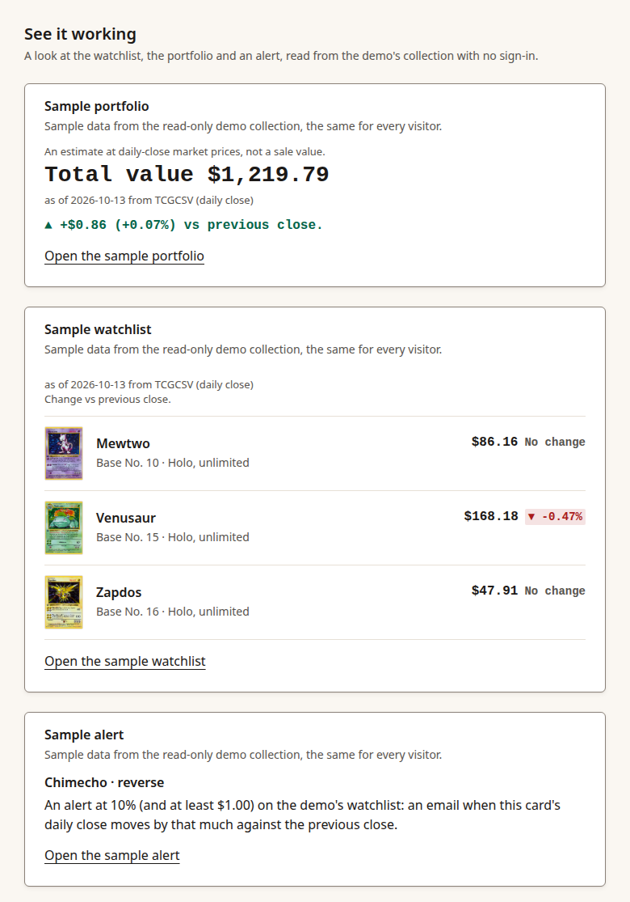
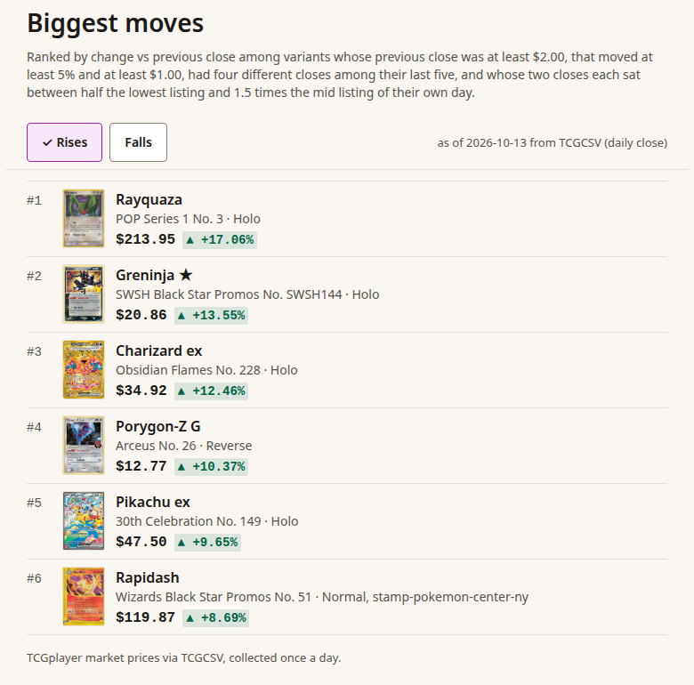
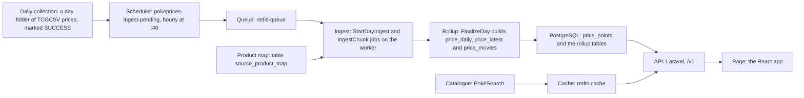

# PokéPrices

PokéPrices is a Pokémon card price tracker, live at <https://pokeprices.andrestheperez.com>: search a card, see what it closed at, how that compares with the previous close and how its price has moved. Prices are collected once a day; each one is shown with its source and the day it is as of, and none is an intraday quote.

PokéPrices is a personal portfolio project, not a business. It has no ads, no affiliate links and no paid features, and it sells no data. It exists to show how I build and run software.

The code is published to be read, and all rights are reserved.

## See it working

You do not need an account. Open the [home page](https://pokeprices.andrestheperez.com/) and scroll to "See it working". The Watchlist, Portfolio and Alerts pages also open without signing in, and each says it shows sample data. For what needs a session, press `Try the read-only demo` on the home page. That signs the browser in to a shared account with a watchlist, a portfolio and a sample alert, in which nothing can be changed. No address opens the demo by itself. The home page also shows a sample of the demo's collection under "See it working" with no sign-in: its portfolio total, three watched cards and an alert.







## What it is built with

- **API:** PHP 8.5 and Laravel 13, with Fortify and Sanctum for accounts and sessions, served under `/v1`. Tests run with Pest.
- **Web:** React 19.3.0, TypeScript 6.0.3, Vite 8.3.4 and Tailwind CSS 4.3.3, with TanStack Query 5.104.2 for reads and lightweight-charts 5.2.1 for the price chart. Tests run with Vitest 5.0.3.
- **Data:** PostgreSQL 17 for prices and accounts; two Redis 8 instances, one for the job queue and one for the cache.
- **Run:** Docker Compose, with the built app served by unprivileged nginx. Node 22 builds the web app.
- **Where the data comes from:** TCGplayer market prices, collected once a day through TCGCSV; card names and pictures from the PokéSearch catalogue, a separate project.

## How a price gets to the page



The collector writes a day folder; its code is not in this repository. The hourly scan at :40 queues an ingest for each new day. The product map says which card variant each marketplace product belongs to. When every chunk of a day is in, the rollup writes the day's closes and the movers board. The API reads those tables, and reads card names and pictures from the catalogue through the cache.

## What is interesting

- **Every price says where it is from and when.** A card page stamps each variant's price `as of <day>
  from TCGCSV (daily close)` and prints the day of the previous close beside the change. A list (the
  movers board, the watchlist, the portfolio) is stamped once with the day or days of its closes and
  their source, and says once that its changes are against the previous close. The rules are in
  [`docs/WEB.md`](docs/WEB.md#what-every-price-shows).
- **Marketplace products are mapped to catalogue cards, and the map is audited.** The price feed lists
  marketplace products; a product map decides which card variant each price belongs to. Five audit
  checks (`pokeprices:map:audit`: `names`, `constraints`, `coverage`, `ambiguity`, `priced`) and a
  golden set judge a new map before history is replayed onto it: see
  [Map rebuild then replay](docs/OPERATIONS.md#map-rebuild-then-replay).
- **The movers board ranks only real market moves.** A variant is ranked only when it moved at least 5%
  and at least $1.00 from a previous close of at least $2.00, when four of its last five closes differ,
  and when both closes lie between half the low listing and one and a half times the mid listing. The
  thresholds and the measurements behind them are in
  [`docs/measurements/movers-eligibility.md`](docs/measurements/movers-eligibility.md).
- **Price moves go out as signed webhooks, and the read-only demo shows one.** When a card on an
  account's watchlist or portfolio moves by at least 5% and $1.00 between two daily closes, each of the
  account's signed webhooks gets a message signed with the Standard Webhooks scheme (HMAC-SHA256);
  per-card alerts go by email or Discord. The demo's Alerts page shows a sample delivery with its
  headers, its exact body and a published sample secret, so the signature can be checked by hand;
  nothing is ever sent from the demo. See [`docs/ALERTS.md`](docs/ALERTS.md#the-demos-samples).
- **The API contract, the web app's types and the code cannot drift apart unnoticed.**
  [`openapi/api.json`](openapi/api.json) is exported from the API code and
  [`web/src/api/schema.d.ts`](web/src/api/schema.d.ts) is generated from it; `make test` fails when
  either differs from a fresh copy. `make gates` runs every gate of
  [`gates/manifest-P0.md`](gates/manifest-P0.md) into a scorecard.

Built by [Andres Perez](https://andrestheperez.com).

## In this repository

The card catalogue itself lives in PokéSearch; this repository holds the prices, the accounts and the alerts built on top of it.

## Layout

- `api/`: the Laravel 13 API, served under `/v1`.
- `web/`: the single-page app (React 19 + Vite + TypeScript + Tailwind v4).
- `compose.dev.yml`: the whole development runtime.
- `gates/`: the list of checks `make gates` runs, with the records that pin their settings so they are not loosened by accident.
- `scripts/`: the script that sums the gate results into a scorecard, the one that turns a scorecard into a pass or fail for a phase, and one script per gate.

## Development

```sh
make init                                  # bring up the core services, install dependencies, create api/.env once
make test                                  # unit suites: Pest, Vitest, tsc, eslint; then openapi/api.json and web/src/api/schema.d.ts must equal a fresh export and a fresh generation; CI runs exactly this on every non-draft PR
make gates                                 # run every gate in gates/manifest-P0.json (the full check run; not part of CI)
make verdict FINDINGS=<path/to/findings.json>   # turn a scorecard into a pass or fail for a phase (not part of CI)
make down                                  # stop the stack (volumes are kept)
```

Every PHP and Node tool runs inside the compose services
(`docker compose -f compose.dev.yml exec -T ...`); nothing is installed on the host. The dev site
is `http://pokeprices.localhost:8095`. How prices are ingested, checked, replayed and repaired is in
[`docs/OPERATIONS.md`](docs/OPERATIONS.md). What each web page shows, how the pages refresh and how to
see a change on the dev site is in [`docs/WEB.md`](docs/WEB.md). How accounts, sessions, the demo, the watchlist and
portfolio, data export and deletion work is in [`docs/ACCOUNTS.md`](docs/ACCOUNTS.md). How alerts, signed webhooks and
the daily digest work is in [`docs/ALERTS.md`](docs/ALERTS.md).

## Reserved paths

Laravel owns `/v1/*`, `/up`, `/sanctum/*`, `/login`, `/logout`, `/register`, `/forgot-password`,
`/reset-password`, `/email/*`, `/user/*` and `/two-factor-challenge`. The SPA owns every other
path, including `/about` and its account pages: `/sign-in`, `/sign-up`, `/password/forgot`,
`/password/reset`, `/account`, `/account/verify-email`, `/watchlist`, `/portfolio` and `/alerts`.
